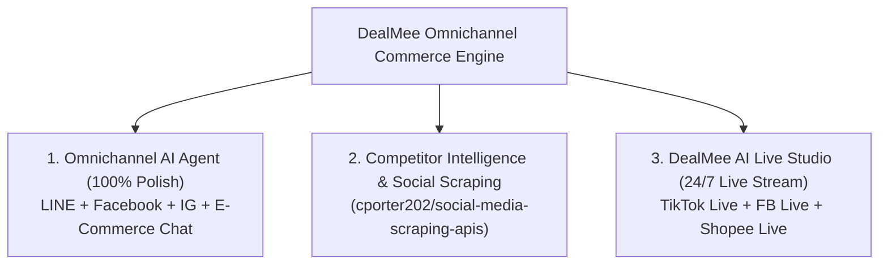

# แผนยุทธศาสตร์การพัฒนา DealMee AI สู่ Next-Gen AI Commerce
**DealMee Omnichannel AI Agent, Competitor Intelligence & AI Live Studio**

> **เป้าหมายหลัก:** ยกระดับ DealMee จากแชทบอทตอบข้อความ สู่แพลตฟอร์ม "พนักงานขายดิจิทัลครบวงจร 24 ชม." ที่สร้างมูลค่าธุรกิจหลักหมื่น-หลายหมื่นบาทต่อเดือน โดยร้านค้าแทบไม่ต้องทำอะไร นอกจากการรอแพ็คสินค้าเมื่อมีออเดอร์เข้ามา

---

## 📌 สรุป 3 เสาหลักยุทธศาสตร์ (3 Strategic Pillars)



---

## 1. เสาหลักที่ 1: ตรวจสอบและยกระดับ Omnichannel AI Agent สู่ความสมบูรณ์แบบ 100%
*(LINE OA, Facebook Messenger, Instagram Direct, และ E-Commerce Inbox)*

### 1.1 สถานะปัจจุบัน (Current Status: ~85-90% Verified)
* **LINE Official Account:**
  * ✅ ระบบ AI Sales Agent ตอบคำถามด้วย Knowledge Base และ Sales Workflow 5 ขั้นตอน
  * ✅ การส่งการ์ดสินค้าสไลด์ (LINE Flex Message Carousel) พร้อมรูปภาพ, ราคา, สถานะสต็อก, และปุ่มสั่งซื้อด่วน
  * ✅ ตรวจสอบสลิปโอนเงิน EasySlip แม่นยำ 100% และคำนวณค่าจัดส่งแยกพื้นที่
  * ✅ ระบบ Admin Takeover สลับคนคุย พักบอท 1 ชม. และ Auto-Resume กลับมาทำงานอัตโนมัติ
* **Facebook Messenger:**
  * ✅ ผ่านการทดสอบ Webhook Handshake และรับ-ส่งข้อความกับเพจจริงสำเร็จ
  * ✅ ระบบ Generic Template Carousel ส่งการ์ดสินค้าพร้อมรูปภาพและราคา
  * ✅ รองรับ Postback เมื่อลูกค้ากดปุ่ม "🛒 สั่งซื้อสินค้านี้" เพื่อเข้าสู่ขั้นตอนสรุปยอด
  * ✅ ระบบดึงชื่อและรูปโปรไฟล์ลูกค้า Facebook เข้าสู่ระบบ CRM อัตโนมัติ

### 1.2 แผนงานที่ต้องทำต่อและทดสอบจนสมบูรณ์:
1. **LINE & Facebook End-to-End Stress Testing:**
   * ทดสอบทุกสถานการณ์จริง: การถามหาสินค้าที่หมดสต็อก, การเปลี่ยนไซส์/สี, การขอใบเสนอราคาทางการ, การส่งสลิปปลอม/สลิปซ้ำ
2. **Instagram Direct Messenger Integration (IG):**
   * เชื่อมต่อ Instagram Graph API (Messenger Platform for Instagram)
   * ใช้โครงสร้าง Webhook ร่วมกับ Facebook Messenger ทำให้ร้านค้าที่มีบัญชี IG ธุรกิจ สามารถเปิดให้บอทตอบแชทและส่งการ์ดสินค้าใน IG ได้ทันที
3. **E-Commerce Chat Ingestion (Shopee & TikTok Shop):**
   * ดึงข้อความแชทจาก Shopee Open Platform และ TikTok Shop Partner API เข้ามาแสดงผลใน Unified Inbox (`/dashboard/inbox`)
   * แอดมินสามารถดูและตอบแชทจากทุกช่องทางได้ในหน้าจอเดียว พร้อมระบบ AI Copilot Draft

---

## 2. เสาหลักที่ 2: ฟีเจอร์ส่องร้านคู่แข่ง (Competitor Intelligence & Market Insights)
*อ้างอิงและเชื่อมโยงเทคโนโลยีจาก: [cporter202/social-media-scraping-apis](https://github.com/cporter202/social-media-scraping-apis.git)*

### 2.1 วัตถุประสงค์
ช่วยให้ร้านค้าของ DealMee รู้ทันการเคลื่อนไหวของคู่แข่งในตลาด เช่น รู้ว่าคู่แข่งขายสินค้าอะไรดี, ตั้งราคาเท่าไหร่, จัดโปรโมชั่นแบบไหน, และทำคอนเทนต์อะไรที่กำลังเป็นไวรัล

### 2.2 สถาปัตยกรรมฟีเจอร์ "DealMee Spy & Market Copilot"

```text
[คลัง API: social-media-scraping-apis]
           │
           ▼ (สกัดข้อมูลเฉพาะทาง)
┌─────────────────────────────────────────────────────────────┐
│ 1. Competitor Product & Price Tracker                       │
│    • ตรวจจับการเปลี่ยนแปลงราคาสินค้าของคู่แข่ง                  │
│    • แจ้งเตือนเมื่อคู่แข่งลดราคา หรือจัดโปรโมชั่น Flash Sale       │
├─────────────────────────────────────────────────────────────┤
│ 2. Top-Performing Content & Engagement Scraper              │
│    • ดึงคลิป TikTok / Reels / โพสต์ FB ของคู่แข่งที่ยอดวิวสูงสุด   │
│    • วิเคราะห์แฮชแท็ก (Hashtags) และแคปชั่นที่คนกดไลก์เยอะที่สุด   │
├─────────────────────────────────────────────────────────────┤
│ 3. AI Marketing Recommendation                              │
│    • DealMee Copilot วิเคราะห์และแนะนำราคาขายที่แข่งขันได้      │
│    • ร่างสคริปต์โพสต์และแคปชั่นขายของที่ดีกว่าคู่แข่งให้ร้านค้า      │
└─────────────────────────────────────────────────────────────┘
```

### 2.3 ขั้นตอนการพัฒนาและทดสอบ:
1. สร้างโมดูลแดชบอร์ดใหม่: `/dashboard/competitors` (หน้าส่องคู่แข่ง)
2. รองรับการเพิ่ม Link เพจ Facebook, ช่อง TikTok, หรือ IG ของร้านคู่แข่งที่ต้องการติดตาม
3. รันระบบสแกนข้อมูลและสรุป Insight ประจำสัปดาห์ส่งเข้า LINE ร้านค้า

---

## 3. เสาหลักที่ 3: ระบบ DealMee AI Live Studio (24/7 Virtual Commerce Streamer)
*สุดยอดฟีเจอร์เพิ่มมูลค่าแพลตฟอร์มสู่หลักหมื่น/เดือน รองรับ TikTok Live, Facebook Live, และ Shopee Live*

### 3.1 คุณค่าทางธุรกิจ (Business Value Proposition)
* **สำหรับร้านค้า:** เปิดไลฟ์สดขายของได้ตลอด 24 ชั่วโมง โดยไม่ต้องจ้างสตรีมเมอร์ ไม่ต้องเฝ้าหน้าจอ
* **สโลแกน:** *"AI ไลฟ์สดขายของวนไป 24 ชม. ตอบสด สลับตะกร้า ปิดการขาย — คุณรอตื่นมาแพ็คของส่งอย่างเดียว"*

### 3.2 องค์ประกอบทางเทคนิคทั้ง 5 ส่วน:

#### ส่วนที่ 1: Real-time Comment Listener (ตัวดักฟังคอมเมนต์สด)
* เชื่อมต่อ WebSocket กับ TikTok Live, Facebook Live API (`live_comments`), และ Shopee Live
* ดักจับข้อความแบบเสี้ยววินาที เช่น *"ขอดูตะกร้า 3"*, *"มีสีอะไรบ้าง"*, *"CF 01"*

#### ส่วนที่ 2: DealMee AI Sales Brain (สมองวิเคราะห์สินค้า)
* เชื่อมโยงกับฐานข้อมูล [Products](/dashboard/products)
* เมื่อมีคนถามหาตะกร้า 3 ➡️ AI ดึงชื่อสินค้า, ราคา, จำนวนสต็อกคงเหลือ, และสเปกสินค้ามาร่างเป็นคำตอบทันที

#### ส่วนที่ 3: DealMee OBS Live Overlay Widget (เว็บแสดงภาพบนจอ Live)
* URL เฉพาะร้าน: `https://dealmee.app/live/overlay/[shop_id]`
* ร้านค้านำลิงก์นี้ไปแปะใน OBS Studio เป็น "Browser Source"
* หน้าจอจะแสดงการ์ดสินค้าแบบเคลื่อนไหว (Animated Product Card) ที่จะ **สลับเปลี่ยนรูปสินค้า ราคา และเลขตะกร้าตามคอมเมนต์สดๆ อัตโนมัติ**

#### ส่วนที่ 4: Thai Neural Voice (TTS) & Digital Human
* แปลงข้อความคำตอบเป็นเสียงพูดภาษาไทยที่สดใส สมจริง และเป็นธรรมชาติ
* เล่นเสียงออกอากาศสดในไลฟ์ พร้อมขยับปากอวตาร AI (Virtual Human Streamer)

#### ส่วนที่ 5: Auto-Pin & Instant Checkout (ปักหมุดตะกร้า & ปิดการขาย)
* **TikTok / Shopee:** ยิง API สั่ง **Pin ตะกร้าสินค้า** เด้งขึ้นมาบนจอมือถือของผู้ชมทันที
* **Facebook Live:** เมื่อผู้ชมพิมพ์ "CF" ➡️ บอทส่งการ์ดสินค้าพร้อมปุ่มชำระเงินทักเข้า Messenger ทันทีใน 1 วินาที

---

## 📅 ตารางแผนงานและการทดสอบอย่างเข้มงวด (Rigorous Testing Phases)

> **หลักการสำคัญ:** ทุกฟีเจอร์ต้องผ่านการทดสอบจำลอง (Simulation Test) และทดสอบบนระบบจริง (Live Environment Test) จนมั่นใจ 100% ก่อนเปิดให้ร้านค้าใช้งานจริง

| เฟสการทำงาน | งานสำคัญ | การทดสอบความถูกต้อง (Test & Verification) |
| :--- | :--- | :--- |
| **Phase A** | ตรวจสอบ Omnichannel AI Agent (LINE + FB + IG) | • Stress-test scenario การตอบกลับ 20 บทสนทนาพร้อมกัน<br/>• ทดสอบระบบ Auto-Resume เมื่อครบ 1 ชม.<br/>• ทดสอบการส่งรูปและรับออเดอร์ใน Messenger |
| **Phase B** | ระบบส่องคู่แข่ง (Competitor Intelligence) | • ทดสอบการดึงข้อมูลโพสต์และราคาจาก Social Scraping APIs<br/>• ทดสอบความถูกต้องของสถิติ Engagement และความปลอดภัยของ Proxy |
| **Phase C** | DealMee AI Live Overlay & Comment Switcher | • ทดสอบหน้าจอ OBS Browser Source แสดงผลแบบ 60fps<br/>• ทดสอบการสลับตะกร้าเมื่อจำลองคอมเมนต์จากผู้ชม |
| **Phase D** | AI Voice Response & Marketplace Pinning | • ทดสอบความเร็วในการตอบของเสียงพูดไทย (< 2 วินาที)<br/>• ทดสอบการสั่ง Pin ตะกร้าบน TikTok/Shopee ผ่าน API |

---
*เอกสารนี้ถูกบันทึกเป็นคู่มือการพัฒนาหลักของโปรเจกต์ DealMee AI*
